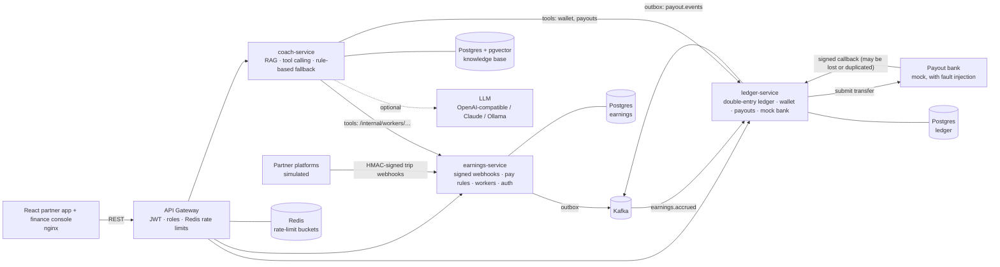
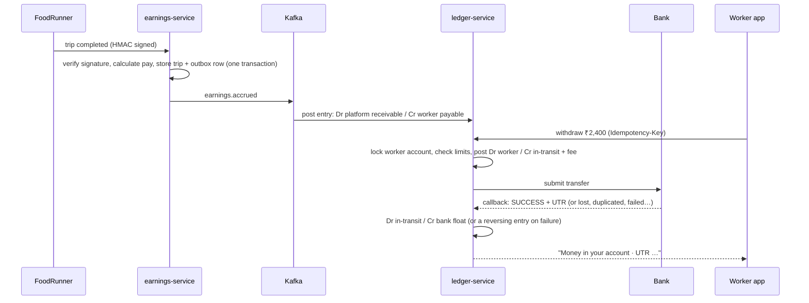

# GigPay

**Instant earned-wage payouts for India's delivery and ride partners, built on a double-entry ledger,
with an AI money coach that knows each worker's own trips.**

A delivery partner finishes a trip at 1 PM but usually waits until next week to be paid. GigPay records
every trip from every platform the worker drives for, shows exactly how each trip was paid, and lets them
take money they have *already earned* to any UPI ID in seconds.

`Java 21` · `Spring Boot 4` · `Spring Cloud Gateway` · `Kafka` · `Redis` · `PostgreSQL + pgvector` ·
`LangChain4j (RAG + tool calling)` · `React 19` · `Docker` · `Kubernetes`

> **Who is this page for?** Everyone. Start with [The problem](#the-problem) and [Screens](#screens)
> for the product, [Run it](#run-it) and [How to test it](#how-to-test-it) to try it, and
> [How it works](docs/HOW-IT-WORKS.md) for the full walkthrough. Designers: see [For designers](#for-designers).

---

## The problem

- **Gig workers live day to day, but get paid week to week.** NITI Aayog estimated 77 lakh gig workers
  in India in 2020-21 and projects 2.35 crore by 2029-30. Most are paid weekly. When the bike needs
  a repair on Wednesday, the usual options are a moneylender or an instant-loan app.
- **Pay is opaque.** The most common complaint isn't the rate. It's not knowing *why* a trip paid ₹34
  instead of ₹60, what the platform kept, or how close the daily bonus is.
- **Moving money is hard to get right.** Payout rails time out, banks go down, and callbacks get lost
  or arrive twice. A wallet that pays someone twice, or loses ₹500 of a worker's money, is worse than
  having no wallet at all.

## What GigPay does

| For | What they get |
|---|---|
| **Workers** | One balance across FoodRunner, RideNow and QuickDrop. "Get paid now" sends up to 90% of earned money to UPI for a flat ₹5. This isn't a loan, so there's no interest. Every trip has a line-by-line pay breakdown, streak-bonus progress and a 7-day chart. |
| **Workers, in their language** | A money coach that answers "why did I earn less today?" from their real trips, and "how do I register on e-Shram?" or "do I pay income tax?" from a cited knowledge base. The built-in engine understands common Hinglish questions ("aaj kitna kamaya?"); with an LLM configured it can reply in Hindi. |
| **GigPay's finance team** | Live books: bank float, money owed to workers, money platforms owe, payouts in transit, fee income. A trial balance that must always be exactly zero, bank-vs-ledger reconciliation, the full journal, and a fault-injection panel that makes the mock bank misbehave on demand. |

### Screens

| Screen | URL | What you see |
|---|---|---|
| Landing page | `/` | The product story: an animated phone (trips arriving, a payout completing), a live ledger posting balanced entries, the chaos-test results and the architecture |
| Partner sign-in | `/login` | Mobile number + 4-digit PIN, with one-tap demo accounts |
| Overview | `/app` | Earned balance, "Get paid now", today / per-hour / week / tips, 7-day chart, streak bonuses, earnings by platform |
| Trips | `/app/trips` | Last 7 days, sortable by "lowest paid"; open a trip for its pay breakdown |
| Wallet | `/app/wallet` | Withdraw (quick 25% / 50% / Max), live payout progress with the bank's UTR, payout history, ledger statement |
| Coach | `/app/coach` | Chat with suggested questions; shows which of your data it read and the sources it cites |
| Finance console | `/finance` | Overview, payouts, journal, reconciliation and bank fault injection, with simulator and job controls |

---

## Architecture



### The life of one rupee



## Engineering decisions (and why)

| Decision | Why |
|---|---|
| **Double-entry ledger in Postgres, money as integer paise** | Every movement is an entry whose legs sum to zero, so money can't appear or vanish. Floats never touch money. |
| **Append-only, idempotent entries** (unique idempotency key per entry) | Kafka redelivers and clients retry. Posting the same entry twice is a no-op, and mistakes are fixed with reversing entries, never edits, so the journal is a complete audit trail. |
| **Lock the involved accounts in id order** (`SELECT … FOR UPDATE`) | Two taps on "Withdraw" (or two phones) can't both spend the same balance, and concurrent entries can't deadlock. Covered by a concurrency test. |
| **Earned wage access, not credit** | A worker can take at most 90% of what they've *already earned* (the rest covers trips a platform might claw back), minus a flat ₹5 fee, up to ₹5,000 and 3 payouts a day. The rules are pure functions with unit tests. |
| **Payouts as a state machine:** `CREATED → SUBMITTED → SUCCEEDED / RETRY / FAILED` | Transient bank errors retry with exponential backoff, up to 4 attempts. Permanent failures post a reversing entry that returns the amount *and the fee*. A poller asks the bank about anything stuck for 15 s, in case its callback was lost. Duplicate callbacks are ignored. |
| **One bank reference per attempt** (`po_….1`, `po_….2`) | A timed-out request may or may not have reached the bank, so its retry reuses the same reference and the bank de-duplicates it: never paid twice. Only after the bank definitively fails an attempt does the next one get a new reference. Late callbacks about an old attempt are ignored. (The first version reused the payout id for every attempt, so a retry after a bank failure could never succeed. The chaos test caught it.) |
| **Money in flight lives in a clearing account** | Between "sent" and "confirmed", the money is in `clearing:payouts-in-transit`. Reconciliation checks that this equals exactly the payouts still in flight. |
| **Reconciliation against the bank's own records** (every minute, and on demand) | Every transfer the bank paid must belong to a `SUCCEEDED` payout with the same amount; every `SUCCEEDED` payout must have exactly one successful transfer (zero means unpaid, two means paid twice); in-transit must equal payouts in flight; the trial balance must be zero. |
| **HMAC-SHA256 signed webhooks with a 5-minute replay window** | Anyone can POST to a webhook URL. Unsigned, tampered or replayed trip reports are rejected before parsing. |
| **Transactional outbox + `FOR UPDATE SKIP LOCKED` relay** | The trip row and its Kafka event commit together. Replicas relay and process payouts in parallel without leader election. |
| **Pay is calculated and stored line by line** | Base, distance, wait time, peak boost, commission, tip and streak bonus are each a line the worker sees. Transparency is the feature. |
| **Coach: hybrid RAG** (pgvector + Postgres full-text, fused with Reciprocal Rank Fusion) **plus tool calling** | Policy questions get cited answers from a curated knowledge base. Questions about *your* pay call tools that read your own trips, wallet and payouts. The worker id comes from the gateway, never from the model, so the coach can't read anyone else's data. |
| **In-process embeddings** (all-MiniLM-L6-v2 on ONNX) **and a rule-based fallback** | It works with no API key and costs nothing per question. Set one environment variable to use OpenAI-compatible APIs, Claude or a local Ollama model. |
| **Identity at the edge** | The gateway verifies the JWT, strips any client-sent `X-User-*` headers and enforces the finance role. Services read the worker id only from the gateway's headers. |
| **Per-route rate limits in Redis**: 3-request burst on withdrawals, 6 on the coach | Money and LLM calls are the expensive endpoints. Each route has exactly one limiter: stacking a global limiter on top made both share one bucket with conflicting settings, a bug found and fixed in testing. |

## Measured results (local Docker run, simulated platforms and bank)

| Metric | Result |
|---|---|
| Instant payout, tap to "money in your account" | ~3.5 s median (the mock bank adds a 2.5 s settlement delay) |
| Back-fill: 6 days of trips for 40 workers | ~2,950 signed webhooks → trips → Kafka → ledger entries in ~32 s |
| Chaos run: 40 weekly payouts with 40% bank failures, 40% lost callbacks, 40% duplicate callbacks, 30% rate limiting | All 40 reached a final state in ~37 s: 36 paid (14 of them on a later attempt after a bank failure), 4 failed after 4 attempts and were reversed. Trial balance 0, reconciliation 0 issues. |
| Same `Idempotency-Key` sent twice | Same payout returned, charged once |
| Six rapid withdrawals | The first 3 reach the service; the rest get HTTP 429 |

---

## Run it

Requirements: Docker with about 4 GB of memory for containers.

```bash
docker compose up --build          # first build takes a few minutes
open http://localhost:3003          # landing page; "Open the app" signs in (9000000001 / PIN 1234)
open http://localhost:3003/finance  # finance console: finance / gigpay
```

1. In the **finance console**, press **Start trips**. GigPay back-fills six days of trips for 40 workers
   (about 30 s), then streams live trips at 15 per minute.
2. Sign in to the **partner app** as Ravi and explore Overview, Trips, Wallet and Coach.
3. On **Wallet**, tap **50%** and **Send**. Watch the payout go to the bank and come back with a UTR.

Other demo workers: Pooja Devi `9000000002`. Every seeded worker's PIN is `1234`.

**Optional: use a real LLM for the coach.** Copy `.env.example` to `.env` and set `AI_PROVIDER`,
`AI_API_KEY` and `AI_MODEL`. Without one, the coach answers with its built-in rule-based engine from the
same data and knowledge base.

### Develop locally

```bash
docker compose -f docker-compose.infra.yml up -d       # Postgres (pgvector), Redis, Kafka only
./mvnw package                                         # build + 18 tests (Testcontainers needs Docker)
java -jar services/earnings-service/target/earnings-service-1.0.0.jar     # :8101
java -jar services/ledger-service/target/ledger-service-1.0.0.jar         # :8102
java -Xmx512m -jar services/coach-service/target/coach-service-1.0.0.jar  # :8103
java -jar services/gateway/target/gateway-1.0.0.jar                       # :8080
cd frontend && npm install && npm run dev                                 # :5175, proxies /api to :8080
```

### Kubernetes

```bash
kubectl apply -k k8s/
```

Includes startup, readiness and liveness probes; requests and limits; HPAs; PodDisruptionBudgets;
non-root read-only containers; NetworkPolicies (only the gateway, the coach and the ledger itself can
reach the ledger); and an nginx Ingress. Replace the bundled Postgres, Redis and Kafka with managed
services in production, and point `PROVIDER_URL` at a real payout provider.

## How to test it

- **Automated:** `./mvnw verify` runs 18 tests, including Testcontainers integration tests on real
  Postgres: concurrent withdrawals can't double-spend, idempotent payouts, reversals, retries under a
  new bank reference, and a random storm of operations after which the books still balance.
- **End to end:** with the stack running, `./scripts/smoke-test.sh` checks sign-in, roles, spoofed
  headers, the simulator, a real withdrawal to completion, idempotency, limits, the coach, the trial
  balance, reconciliation and rate limiting.
- **In a real browser:** with the stack running, `cd e2e && npm install && npx playwright install chromium && npm test`
  runs Playwright through the 23-step worker and finance journey: landing page, staff sign-in (including a wrong password), simulated platforms, worker sign-in, trips, below-minimum and invalid-UPI withdrawals, a real instant payout to its UTR, the coach, role checks, then the finance console with the bank broken on purpose, reconciliation and the trial balance. It also checks that no page scrolls sideways on a 390 px phone.
- **By hand:** [docs/TESTING.md](docs/TESTING.md) is a click-by-click script with what you should see
  at each step, including the chaos test.

## API (via the gateway)

| Method | Path | Purpose |
|---|---|---|
| `POST` | `/api/auth/worker` · `/api/auth/admin` | Sign in (mobile + PIN, or finance) |
| `GET` | `/api/earnings/me` · `/summary?period=today\|week\|lastweek` · `/daily` | Profile and earnings |
| `GET` | `/api/earnings/trips?order=recent\|lowest` · `/incentives` | Trips with pay breakdown, streak progress |
| `GET` | `/api/wallet` · `/payouts` · `/payouts/{id}` · `/statement` | Balance, limits, payouts, ledger statement |
| `POST` | `/api/wallet/withdrawals` | Instant payout (`Idempotency-Key` supported) |
| `POST` | `/api/coach/chat` · `GET /suggestions` · `/status` | Money coach |
| `GET` | `/api/ledger/admin/overview` · `/journal` · `/payouts` · `/accounts` | Finance views (finance role) |
| `GET/POST` | `/api/ledger/admin/reconciliation` · `/reconciliation/run` | Bank vs ledger reconciliation |
| `GET/PUT` | `/api/ledger/admin/faults` | Mock bank fault injection |
| `POST` | `/api/ledger/admin/jobs/settle-platforms` · `/jobs/weekly-payout` | Run scheduled money movements now |
| `POST` | `/api/earnings/admin/simulator/start` · `/stop` | Simulated partner platforms |
| `POST` | `/webhooks/platforms/{platform}/trips` | Signed trip webhook (earnings-service, not via the gateway) |

OpenAPI: `/api/earnings/docs` and `/api/wallet/docs` on the services.

## Project layout

```
contracts/          Kafka event records shared by the services
services/
  gateway/          Spring Cloud Gateway: routing, JWT, roles, per-route rate limits
  earnings-service/ Workers, sign-in, signed trip webhooks, pay calculator, platform simulator
  ledger-service/   Double-entry ledger, wallet and limits, payouts, mock bank, settlement, reconciliation
  coach-service/    Hybrid RAG over the knowledge base (src/main/resources/kb), tools, LLM or rule-based answers
frontend/           React + TypeScript + Tailwind partner app and finance console (nginx in production)
k8s/                Kustomize manifests
docs/               How it works, testing guide
scripts/            End-to-end API smoke test
e2e/                Playwright browser tests (full user journeys, phone-width layout)
```

## For designers

- **Feel:** calm fintech. Paper backgrounds, ink text, one confident colour pair, generous whitespace,
  hairline dividers instead of heavy shadows. No gradients on content, no emoji, no decorative AI icons.
- **Palette:** paper `#f6f5f1`, ink `#0f1a14`, forest `#17402a` (primary actions, the balance card),
  lime `#c6f36d` (the "money" accent, used sparingly), positive `#18794e`, negative `#c2362b`.
  All tokens are in `frontend/src/index.css` (`@theme`).
- **Type:** Geist for UI and headings (tight tracking on large sizes), Geist Mono for IDs, UTRs and the
  ledger. Numbers use tabular figures so columns of rupees line up.
- **Motion:** purposeful and short. The landing page's phone and ledger demos play the real flows;
  sections reveal once on scroll; balances glide to new values; payout steps tick as the bank responds.
  Everything respects the operating system's "reduce motion" setting.
- **Two audiences:** the partner app is mobile-first (bottom tab bar on phones, one primary action,
  plain language); the finance console is a dense desktop dashboard with a sidebar.
- **Trust details worth keeping:** each payout step and the bank's UTR; "not a loan, no interest" and
  why only 90% is available; a line-by-line breakdown for every trip; the coach's data and sources.
- **Open design questions:** onboarding and KYC, a Hindi/regional-language UI (the coach understands
  some Hinglish today), offline and low-bandwidth states, and accessibility on small Android phones.
- Components live in `frontend/src/components/ui.tsx` (Button, Card, Stat, Badge, Segmented, Skeleton,
  Logo) and the landing page in `frontend/src/landing/`. Run `npm run dev` in `frontend/` for hot reload
  (set `API_TARGET=http://localhost:8083` to use the Docker stack's gateway).

## Honest limitations

- The partner platforms and the payout bank are simulated. A real launch needs platform partnerships,
  an RBI-regulated payout partner, KYC, and a legal review of the earned-wage-access model.
- The 90% cap is a fixed buffer. A production system would size it per worker from clawback history.
- The knowledge base summarises public schemes and laws for demonstration. Verify against official
  portals (eshram.gov.in, incometax.gov.in, state labour departments) before relying on it.
- A single Kafka broker and one Postgres instance (one database per service) keep the demo light.
