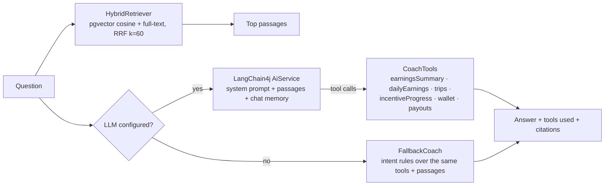

# How GigPay works

Part 1 is for everyone: designers, product people, recruiters. Part 2 is for engineers.

---

## Part 1: in plain English

### The story

Ravi delivers food for FoodRunner and drives for RideNow in Bengaluru. Both apps pay him weekly. On
Wednesday his bike needs a ₹2,000 repair, and he has already earned ₹4,400 this week.

With GigPay:

1. **Every trip shows up within seconds.** When Ravi completes a trip, the platform tells GigPay. GigPay
   checks the message really came from that platform, works out the pay line by line (base pay,
   distance, waiting time, peak-hour boost, commission, tip, bonus), and adds it to his balance.
2. **He taps "Get paid now".** GigPay checks how much he's allowed to take: up to 90% of what he's
   earned (keeping 10% back in case a platform reverses a trip), minus a flat ₹5 fee, and no more than
   ₹5,000 or 3 payouts a day. This is his own money, not a loan, so there's no interest.
3. **The money goes to his UPI ID.** GigPay asks the bank to transfer it. A few seconds later the bank
   confirms with a reference number (UTR), and the app shows "Money in your account".
4. **If the bank fails, nothing is lost.** If the bank rejects the transfer, the amount and the fee go
   back into his balance automatically. If the bank's confirmation gets lost, GigPay asks the bank
   directly. If the confirmation arrives twice, the second copy is ignored.
5. **At the end of the week**, whatever is left is paid out for free.
6. **He can ask questions.** "Why did I earn less today?" The coach looks at his actual trips and
   explains: fewer trips than usual, and 2 more trips would unlock a ₹100 bonus. "Do I need to pay
   income tax?" It answers from a curated knowledge base and shows its sources.

### Where the money comes from

GigPay pays Ravi *before* the platforms pay GigPay. That gap is funded by GigPay's own bank balance,
the **float**. The platforms then settle what they owe on a schedule (weekly in real life, every two
minutes in the demo). GigPay earns the ₹5 fee on instant payouts.

### The finance team's view

The finance console shows where every rupee is:

| Box | Meaning |
|---|---|
| Bank float | Cash in GigPay's bank account, available for payouts |
| Owed to workers | Money workers have earned and not yet taken |
| Platforms owe us | Earnings GigPay has fronted that platforms haven't settled yet |
| In transit | Sent to the bank, not yet confirmed |
| Fee income | GigPay's revenue from instant-payout fees |
| Trial balance | A check that must always say "Books balance" |

---

## Part 2: for engineers

### Services

| Service | Port | Owns | Talks to |
|---|---|---|---|
| `gateway` | 8080 | JWT verification, roles, per-route Redis rate limits | all services |
| `earnings-service` | 8101 | workers, PIN sign-in, platforms, trips, pay rules, the simulator | Postgres `earnings`, Kafka (out) |
| `ledger-service` | 8102 | accounts, journal, payouts, limits, the mock bank, settlement, reconciliation | Postgres `ledger`, Kafka (in/out), earnings-service (UPI IDs) |
| `coach-service` | 8103 | knowledge base, embeddings, retrieval, LLM, tools | Postgres `coach` (pgvector), earnings + ledger internal APIs |
| `frontend` | 80 | React app served by nginx, proxies `/api` to the gateway | gateway |

Each service has its own database (one Postgres instance, one database per service). They share only
the Kafka event records in `contracts/`.

### 1. A trip arrives

`POST /webhooks/platforms/{platform}/trips` with headers `X-GigPay-Timestamp` and
`X-GigPay-Signature = HMAC-SHA256(platformSecret, timestamp + "." + body)`.

1. `WebhookController` rejects bad signatures and timestamps older than 5 minutes *before* parsing JSON.
2. `TripService.record` runs in one transaction:
   - takes a Postgres advisory lock on worker + platform, so the "trips today" count used for streak
     bonuses can't race;
   - `PayCalculator` produces the breakdown lines;
   - inserts the trip (the platform's trip id is the primary key, so a retried webhook is a no-op);
   - inserts an outbox row with an `EarningAccrued` event.
3. The outbox relay (`@Scheduled`, `FOR UPDATE SKIP LOCKED`) publishes to `earnings.accrued`.

### 2. The ledger accrues it

`AccrualConsumer` posts one entry, with the trip id as its idempotency key:

| Account | Debit | Credit |
|---|---|---|
| `platform:FOODRUNNER:receivable` | ₹75.36 | |
| `worker:GW-0001:payable` | | ₹75.36 |

Sign convention: debits are positive and credits are negative, so every entry sums to 0 and so does
the whole book. A liability like `worker:…:payable` has a negative balance; "owed to Ravi" is its
negation.

### 3. Ravi withdraws

`POST /api/wallet/withdrawals {amountPaise, upiId}` with an optional `Idempotency-Key`.

1. A repeated key returns the original payout.
2. Inside one transaction: lock every account the entry will touch, in id order (Ravi's payable,
   in-transit, fees; locking only Ravi's first would deadlock against concurrent reversals), read today's instant-payout usage, run
   `Limits.check` (minimum ₹100, whole rupees, at most 90% of the balance minus the fee, at most ₹5,000
   and 3 payouts a day), insert the payout as `CREATED`, post the entry, and add a `PayoutEvent` to the
   outbox:

| Account | Debit | Credit |
|---|---|---|
| `worker:GW-0001:payable` | ₹2,405 | |
| `clearing:payouts-in-transit` | | ₹2,400 |
| `income:payout-fees` | | ₹5 |

3. `PayoutService.submitDue` (every 500 ms, `SKIP LOCKED`) sends due payouts to the provider and marks
   them `SUBMITTED`. HTTP 429, server errors and timeouts are retriable (other 4xx fail at once): the
   payout moves to `RETRY` with backoff (2, 4, 8 s) and fails after 4 attempts.

**Bank references.** The bank knows each attempt as `payoutId.N` (`po_1a86….1`). A timed-out request
may or may not have reached the bank, so its retry keeps the *same* reference and the bank
de-duplicates it. Only when the bank definitively fails attempt N (for example `NPCI_TIMEOUT` reported
in its callback) does attempt N+1 get a new reference. Callbacks are matched to the current reference,
so a late or duplicate callback about an old attempt changes nothing.

### 4. The bank answers

The mock bank (`MockPayoutProvider`, inside ledger-service) records the transfer, waits
`settleMillis`, then calls `POST /webhooks/provider/payouts` with an HMAC signature. Depending on the
fault settings it may reject the transfer, never call back, call back twice, or return 429.

- **Success:** the payout becomes `SUCCEEDED` with the UTR, and this entry is posted:

| Account | Debit | Credit |
|---|---|---|
| `clearing:payouts-in-transit` | ₹2,400 | |
| `bank:float` | | ₹2,400 |

- **Retriable failure** (the bank's network timed out): the payout goes back to `RETRY` and the next
  attempt uses a new reference. Nothing is posted; the money stays in transit.
- **Permanent failure, or the last attempt failing:** a reversing entry returns the amount and the fee:

| Account | Debit | Credit |
|---|---|---|
| `clearing:payouts-in-transit` | ₹2,400 | |
| `income:payout-fees` | ₹5 | |
| `worker:GW-0001:payable` | | ₹2,405 |

- **Lost callback:** `pollStuck` (every 5 s) asks the provider for the status of anything `SUBMITTED`
  more than 15 s ago.
- **Duplicate callback:** `onResult` locks the payout and ignores it unless it's still `SUBMITTED`.

### 5. Scheduled money movements

| Job | Default | Entry |
|---|---|---|
| Platform settlement | every 120 s | Dr `bank:float` / Cr `platform:X:receivable` |
| Weekly payout (free) | every 6 h, or **Run weekly payout** in the console | Dr `worker:…:payable` / Cr in-transit, then as above |
| Reconciliation | every 60 s | none; it produces a report |

Override them with `SETTLEMENT_EVERY` and `WEEKLY_PAYOUT_EVERY`. Settlement and weekly-payout entries
carry a cycle number in their idempotency key, so two replicas running the same cycle post once.

### 6. Reconciliation

`Reconciler` compares the ledger with the bank's own records (`provider_transfers`):

- every transfer the bank paid belongs to a `SUCCEEDED` payout with the same amount;
- every `SUCCEEDED` payout has exactly one successful transfer: none means the worker wasn't paid,
  two means they were paid twice;
- the in-transit account equals the sum of payouts still in flight;
- the trial balance is zero: the sum of all balances is 0, the sum of all postings is 0, no entry is
  unbalanced, and no cached balance drifts from its postings.

### 7. The coach



- The knowledge base is eight Markdown files in `coach-service/src/main/resources/kb`. They're split
  by `##` section, embedded with all-MiniLM-L6-v2 (ONNX, in-process), and stored with a full-text
  vector in Postgres. They're re-ingested only when a file's hash changes.
- Retrieval is a single SQL statement with two CTEs (vector and lexical), each ranked, fused with
  Reciprocal Rank Fusion.
- The worker id is a `@ToolMemoryId` taken from the gateway's header. The model never sees or chooses
  it, so a prompt like "show me GW-0002's balance" can only ever read the signed-in worker's data.
- Configure the LLM with `AI_PROVIDER` (`openai`, `anthropic`, `ollama`), `AI_API_KEY`, `AI_MODEL` and
  `AI_BASE_URL`. If the LLM call fails, the coach falls back to the rule-based answer.

### 8. Security at the edge

- `AuthenticationFilter` (gateway) strips `X-User-Id`, `X-User-Name` and `X-User-Role` from every
  request, verifies the JWT, and only then adds them back from the token's claims.
- `/api/ledger/admin/**` and `/api/earnings/admin/**` need `role=ADMIN`.
- Five wrong PINs lock a mobile number for 15 minutes. PINs are stored as BCrypt hashes.
- In Kubernetes, NetworkPolicies let only the gateway reach the services' public APIs, and only peer
  services reach `/internal/**`.

### Data model (ledger)

```
accounts         (id, code UNIQUE, name, type, owner_id, balance)        -- balance is a cache of postings
journal_entries  (id, idempotency_key UNIQUE, kind, description, reference, created_at)
postings         (id, entry_id, account_id, amount)                      -- append-only
payouts          (id, idempotency_key UNIQUE, worker_id, kind, amount, fee, upi_id, status, attempts, bank_attempt, …)
provider_transfers (reference = payoutId.N, provider_ref, amount, status, settles_at, callback_sent, …)  -- the mock bank's own books
processed_events (event_id, processed_at)                                -- consumer-side de-duplication
outbox_events    (id, topic, event_key, payload, published_at)
```
